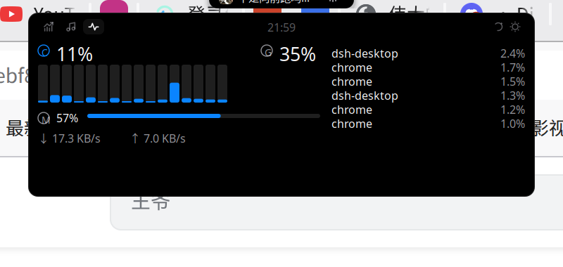
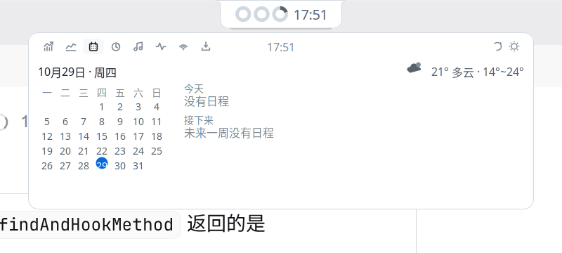
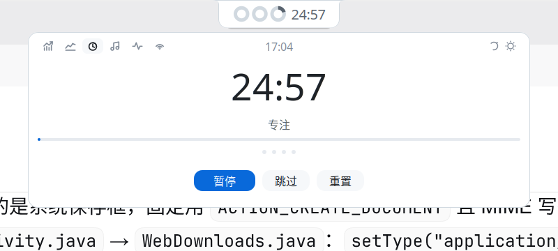
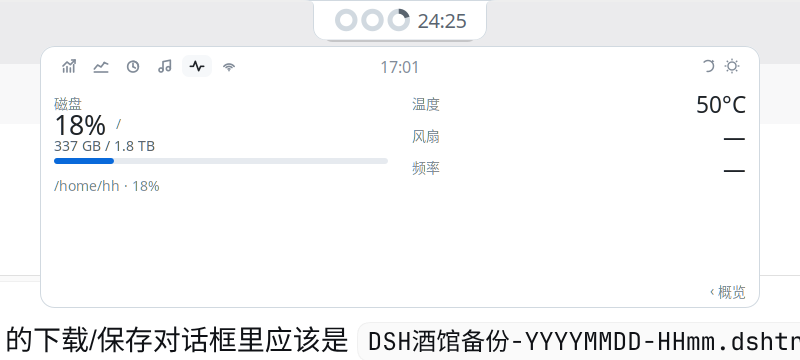
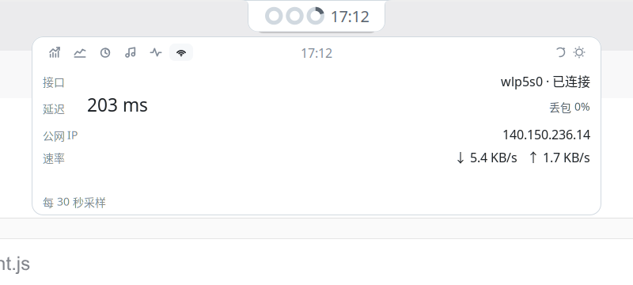

# MintDeck

[](LICENSE)
[](mintdeck@bigmalove/metadata.json)
[](tests)

A Linux Mint / Cinnamon port of [BrimDeck](https://github.com/MoFeng2223/BrimDeck) (Windows 11, C# + WPF):
a Dynamic-Island-style strip that floats at the top of the screen, expands on hover, and shows
**AI coding-tool quota & usage**, **now playing** (MPRIS) and **system monitoring** in one place.

Porting rule: geometry, theme-file format and data models are 1:1 with upstream, while every
Windows-only transport (SMTC, DPAPI, PDH, CDP) is replaced by a Linux standard interface
(MPRIS, procfs, JSONL, libsoup).

<p align="center">
  
  <br>
  <sub>Collapsed: cover, quota rings, title, visualiser and clock — width hugs the content</sub>
</p>

| AI usage (expanded) | Music | System monitor |
| --- | --- | --- |
|  |  |  |

Usage trend page (14 days per source, each in its own unit): 

Agenda / tasks:  

Focus timer, monitor details and the network page:   

| Notch | Capsule | Line |
| --- | --- | --- |
|  |  |  |

中文说明见 [README.md](README.md)（更详细，包含设置、多语言与实现取舍）。

## Install

```bash
git clone https://github.com/bigmalove/mintdeck.git ~/mintdeck && cd ~/mintdeck
tools/install.sh     # symlinks the applet into ~/.local/share/cinnamon/applets/ and installs fonts
tools/enable.sh      # adds it to the panel (or: System Settings → Applets → Add → MintDeck)
```

Cinnamon rescans applets only on startup: log out and back in, or press `Alt+F2`, type `r`, Enter.

The applet's uuid is `mintdeck@bigmalove` and it follows the Cinnamon Spices layout, so once the
submission to [linuxmint/cinnamon-spices-applets](https://github.com/linuxmint/cinnamon-spices-applets)
is merged it can be installed from System Settings → Applets → Download without this script.

Uninstall: `tools/uninstall.sh`.

## Features

| Page | What it shows | Source |
| --- | --- | --- |
| AI usage | per tool: name + plan badge, quota slots (5h / weekly / context), today's and 7-day tokens or credits | Claude Code `~/.claude/projects/**/*.jsonl`; DeepSeek Harness `~/.dsh-desktop/sessions/**/*.jsonl.zstd`; WorkBuddy `~/.workbuddy/workbuddy.db` (`session_usage`, read-only python bridge) |
| Usage trend | one row of 14 daily bars per source, each in its own unit (tokens / credits), with today and window totals | same as above (reuses the parsed sessions, bucketed per calendar day by `daily()`) |
| Agenda | month grid (today ringed, days with events dotted), today's events, next 7 days, and the weather in the top-right corner | local `.ics` files under `~/.local/share/evolution/{calendar,tasks}/**/*.ics` + Open-Meteo (no API key) |
| Focus timer | a 25/5/15 pomodoro: large countdown, phase, progress bar, round dots; start / pause / skip / reset. While focusing, the collapsed clock slot shows the countdown | local state machine `lib/core/pomodoro.js`, no network |
| Music | title, artist, play state; collapsed mode shows the title or the current lyric line | MPRIS (any D-Bus media player) |
| System monitor | overview: CPU total and per-core bars, memory, GPU, throughput, top 6 processes; the “Details ›” link at the footer switches to a second screen with disk usage, temperature, fan and CPU frequency | `/proc/stat`, `/proc/meminfo`, `/proc/net/dev`, `nvidia-smi`, `statvfs`, `/sys/class/thermal`, `/sys/class/hwmon` |
| Tasks | download progress from aria2 JSON-RPC / qBittorrent Web API, container counts (docker/podman), failed systemd user units | local HTTP APIs + `docker ps` / `podman ps` / `systemctl --user --failed`, all async |
| Network | interface and link state, ICMP latency and loss, public IP, live up/down throughput | `/sys/class/net/*`, `ping` (async, 60 s cache), `api.ipify.org` (10 min cache), `/proc/net/dev` |

Quota alerts (Settings → AI usage → Alerts) fire one notification when a quota crosses the warning or
critical line — on crossing only, so growth beyond 90% stays quiet, and context-window fill is not a
quota and never alerts.

Agenda and weather: the weather module only runs when a city is set (empty = no request at all, no guessing of
coordinates); results are cached 10 minutes per city and failures back off for 60 seconds. Calendar events come from
the local calendar only — an empty calendar shows an empty list, never fake entries.

Downloads and tasks: the aria2 JSON-RPC and qBittorrent Web UI URLs are opt-in (empty = disabled); containers are read
through `docker ps` (falling back to `podman ps`), and a missing runtime shows as “no container runtime detected”, not 0.

Focus timer settings (Behaviour → Focus timer): work / short break / long break lengths, long-break interval,
auto-advance, the island countdown, and notifications. Changing a length never interrupts the running phase —
the new value applies from the next phase, otherwise the countdown would jump.

Latency and loss come from `ping -c 3` (async, one probe in flight, 60 s cache); when ICMP is filtered the
page shows `—`, never 0. The public IP is cached for 10 minutes and stays quiet for 60 s after a failure.

On the network page the “—” entries are honest gaps, not zeros: `speed` is unreadable on most Wi-Fi drivers,
ICMP can be filtered, and the public-IP request can fail. Temperature, fan and frequency each come from a
different sysfs tree and go missing independently (desktops usually have no `fan*_input`); the frequency
value is the average of all cores.

Size modes: **auto** (the strip's height and content scale follow how many segments are actually
drawn), plus fixed `compact` / `standard` / `large` tiers. Auto 3 segments equals standard, 5 equals
large, and both geometry and content (fonts, cover, rings, visualiser) scale together.

Interface languages: Simplified Chinese, Traditional Chinese, English, Japanese — switchable at
runtime in the applet settings (the island is drawn with St/cairo, so no shell restart is needed).

## Layout

```
mintdeck@bigmalove/            # the applet (symlinked into ~/.local/share/cinnamon/applets/)
├── applet.js              # lifecycle, hover state machine, settings binding
├── settings-schema.json   # settings (Cinnamon renders the config UI)
├── lib/core/              # pure JS: geometry, theme, log parsing, providers, pricing, i18n, pomodoro, quota alerts
├── lib/linux/             # MPRIS, procfs, sysfs, lyrics/public IP (HTTP), aria2/qBittorrent, calendar .ics
├── lib/deck/              # St/Clutter: collapsed strip, panel, data wiring
├── lib/ui/                # cairo rings, colour helpers
├── themes/                # 8 themes (same format as BrimDeck, interchangeable)
└── fonts/                 # 4 OFL fonts used by the clock styles

po/                        # translation source: mintdeck@bigmalove.pot + en / zh_TW / ja
tools/                     # install / enable / uninstall / dev-reload / i18n pipeline
tests/                     # node --test: geometry, auto-size, themes, logs, providers, procfs, lyrics, i18n, alerts, daily buckets, panel painting
```

## Development

```bash
node --test tests/*.test.js     # 270 tests
tools/dev-reload.sh             # hot-reload the applet after editing code
tools/i18n.sh build             # regenerate i18nData.js and .mo after touching strings/po
```

Cinnamon's `imports` cache does not invalidate when files change; after editing `lib/**` either run
`tools/dev-reload.sh` or restart the shell with `Alt+F2` → `r`.

## Screenshots

All shots live in [`docs/images/`](docs/images) and were taken from a running Cinnamon desktop at 2x DPI:
collapsed strip, three styles (notch / capsule / line), every panel page, the size settings,
the four languages, and the drop shadow on dark and light wallpapers.

## License

Apache-2.0, as a derivative work of BrimDeck (Apache-2.0). See [LICENSE](LICENSE) and [NOTICE](NOTICE).
Bundled fonts are SIL OFL 1.1; the system-monitor palette is adapted from
[ftop](https://github.com/Nongfsq/ftop) (MIT).
