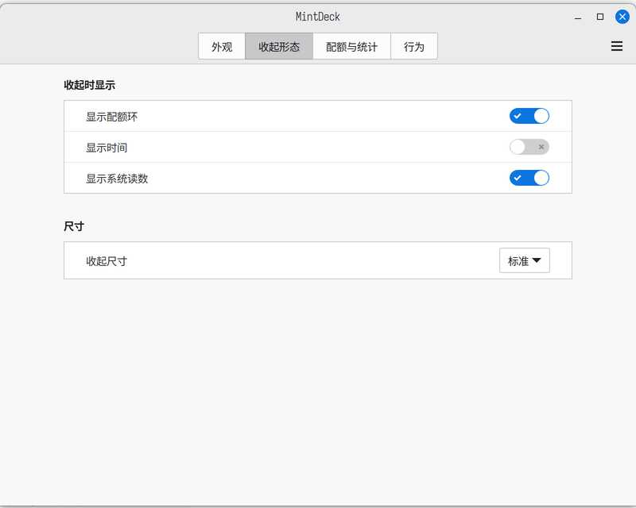
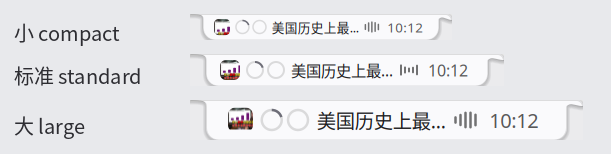
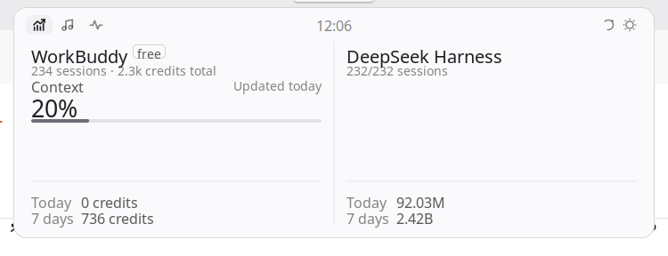
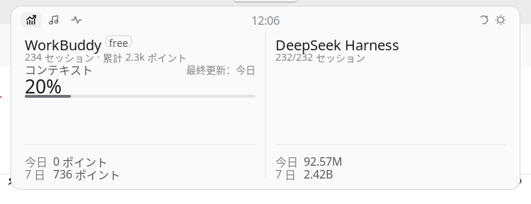

# MintDeck

[](LICENSE)
[](mintdeck@bigmalove/metadata.json)
[](tests)
[](tests)

Cinnamon 桌面上的「灵动岛」：屏幕顶部一条悬浮的小黑条，鼠标移上去展开，集中显示 **AI 编程工具的额度与用量**、**日程与天气**、**正在播放的音乐**、**系统监控**，另有 **番茄钟**、**网络质量** 与 **下载/容器任务** 三页。

<p align="center">
  
  <br>
  <sub>收起态：封面 / 配额环 / 标题 / 律动条 / 天气 / 时钟，宽度贴着内容自动伸缩</sub>
</p>

这是 [BrimDeck](https://github.com/MoFeng2223/BrimDeck)（Windows 11 / C# + WPF）的 Linux Mint 复刻：几何参数、主题文件格式、数据模型都按上游 1:1 移植，Windows 专有的通道（SMTC、DPAPI、PDH、CDP）换成 Linux 的标准接口（MPRIS、procfs、JSONL、Soup）。

英文说明：[README.en.md](README.en.md)（同样的安装步骤，简述功能与目录）

| AI 用量（展开面板） | 音乐 | 系统监控 |
| --- | --- | --- |
|  |  |  |

 

三种外观（同一份内容，只换「外观」设置）：

| 刘海 notch | 胶囊 capsule | 指示条 line |
| --- | --- | --- |
|  |  |  |

深色壁纸上的收起态与投影：

| 深色 | 浅色 |
| --- | --- |
|  |  |

## 安装

```bash
git clone https://github.com/bigmalove/mintdeck.git ~/mintdeck && cd ~/mintdeck
tools/install.sh          # 软链到 ~/.local/share/cinnamon/applets/，并装字体
tools/enable.sh           # 加进面板（也可用「系统设置 → 小程序 → 添加 → MintDeck」）
```

装完屏幕顶部中央就会出现刘海。首次添加 applet 需要 Cinnamon 重新扫描一次：注销重登，或按 `Alt+F2` 输入 `r` 回车。

uuid 是 `mintdeck@bigmalove`，已按 Cinnamon Spices 的目录规范提交到
[linuxmint/cinnamon-spices-applets](https://github.com/linuxmint/cinnamon-spices-applets)：
合并后可以直接在「系统设置 → 小程序 → 获取更多」里装，不用 `tools/install.sh`。

卸载：`tools/uninstall.sh`

## 现在能做什么

| 页面 | 内容 | 数据来源 |
| --- | --- | --- |
| AI 用量 | 每列：工具名 + 套餐徽章、配额槽（5 小时 / 每周 / 上下文）、今日与七日的 Token 或积分 | Claude Code：`~/.claude/projects/**/*.jsonl`；DeepSeek Harness：`~/.dsh-desktop/sessions/**/*.jsonl.zstd`；WorkBuddy：`~/.workbuddy/workbuddy.db` 的 `session_usage`（经 python3 只读桥）+ `storage/skeleton/account-snapshot.json` |
| 用量趋势 | 每个来源一行 14 天柱状图：各自单位（Token / 积分）、今日与合计；0 值只留轨道 | 同上（复用同一批解析结果，`daily()` 切自然日桶） |
| 日程 | 月历（今天带圈、有日程的日子点一下）+ 今日日程 + 未来 7 天；右上角天气，收起态显示天气图标与当前温度 | 本机 `.ics`（`~/.local/share/evolution/{calendar,tasks}/**/*.ics`）+ Open-Meteo（免 key） |
| 专注计时 | 25/5/15 番茄钟：大号倒计时、阶段、进度条、轮次点；开始/暂停/跳过/重置。专注时收起态的时钟位换成倒计时 | 纯本地状态机 `lib/core/pomodoro.js`（node 可测），不联网 |
| 音乐 | 歌名、歌手、播放状态；收起态显示标题或当前歌词 | MPRIS（任何支持 D-Bus 媒体控制的播放器） |
| 系统监控 | 概览：CPU 总值与每核柱、内存、GPU、上下行网速、TOP 6 进程；页脚「详情 ›」切第二屏：磁盘占用、温度、风扇、CPU 频率（收起态可显示读数） | `/proc/stat`、`/proc/meminfo`、`/proc/net/dev`、`nvidia-smi`、`statvfs`、`/sys/class/thermal`、`/sys/class/hwmon`、`/sys/.../scaling_cur_freq` |
| 网络 | 网卡与链路状态、ICMP 延迟与丢包、公网 IP、实时上下行 | `/sys/class/net/*`、`ping`（异步、60s 缓存）、`api.ipify.org`（10 分钟缓存）、`/proc/net/dev` |
| 任务 | 下载（aria2 JSON-RPC / qBittorrent Web API）进度条、容器运行数（docker/podman）、systemd 用户失败单元 | 本地 HTTP API + `docker ps` / `podman ps` / `systemctl --user --failed`（全部异步） |

**专注计时**（行为 → 专注计时）：专注 / 短休息 / 长休息的分钟数、每几轮一次长休息、是否自动进入下一段、
是否在岛上显示倒计时、是否通知。右键菜单里的「专注计时」等价于面板上的开始/暂停。改时长不会打断正在跑的这一段
（新值从下一段生效），不然倒计时会突然跳几十分钟。

**日程与天气**（AI 用量页 → 日程与天气）：填了天气城市才会请求 Open-Meteo（留空 = 完全不发请求，不猜经纬度）；
同城 10 分钟缓存、失败安静 60 秒。日程从本机日历读，读不到就是空列表 —— 不会拿假事件充数。
设置 → 收起形态 → 「收起时显示天气」（默认开）会把天气图标和当前温度放到收起态的时钟左边；取不到读数时这一段整段不出现，不拿「—」占位。

**下载与容器**（AI 用量页 → 下载与容器）：aria2 JSON-RPC 与 qBittorrent Web UI 的地址**留空即关闭**；
容器默认显示（先 `docker ps`，没有 docker 再试 `podman ps`）。这些地址只连本机回环，凭据存在小程序配置里。

**网络页**的延迟与丢包走 `ping -c 3`（异步、60 秒缓存，同一时刻只有一条 ping 在飞）；被防火墙挡住 ICMP 时
就是 `—`，不写 0。公网 IP 走 `api.ipify.org`，成功缓存 10 分钟、失败安静 60 秒。

费用按会话累计的 `totalCostUSD`（Claude 的 `cost-state` 行）取**每个会话最后一条**，按文件 mtime 归入当日（趋势页）/一周内（汇总），不跨状态相加。

趋势页不做「三源堆叠」：token 和积分不是同一种量，混在一张图上每根柱子的高度都没有意义，
所以每个来源一行、各自标尺、各自单位。行序固定（Claude → DSH → WorkBuddy），不会随异步返回顺序跳舞。

配额预警（设置 → AI 用量页 → 提醒）在额度越过预警线、告警线时各弹一次通知；只在**跨过**阈值时响，
85% 之后继续涨不会再响；上下文占用不算配额，不参与预警。

## 设置

系统设置 → 小程序 → MintDeck → 配置。收起态尺寸默认 **自动**：岛的高矮和内容（字体、封面、配额环、律动条、间隙）
跟着「当前真的画出来的段数」走 —— 只有时钟时是一枚 24 高的小刘海，封面 / 配额环 / 标题 / 律动 / 天气 / 时钟齐全才长到 40 高；
宽度永远贴着内容，两侧只留 `16 + 10×缩放`，不会再出现内容缩在中间、两边一片空的情况。
不喜欢它变来变去，可以固定成三档之一：

| 档位 | 刘海 | 胶囊 | 指示条 | 内容缩放 |
| --- | --- | --- | --- | --- |
| 自动 auto | 高 24–40，宽 = 内容 + 2×(16 + 10×缩放) | 同上（留白 10 而非 16） | 长 44–72、厚 3–5 | 0.75 / 0.875 / 1 / 1.125 / 1.25（1–5 段） |
| 小 compact | 200×26 | 172×26 | 44×3 | 0.8125（字 9.5px、封面 16px、环 14.6px） |
| 标准 standard | 238×32 | 196×32 | 56×4 | 1.0（与上游默认逐值一致） |
| 大 large | 282×40 | 232×40 | 72×5 | 1.25（字 14.5px、封面 25px、环 22.5px） |

自动档的 3 段正好等于标准档、5 段等于大档；三档同时驱动表面几何和内容（字体、封面、配额环、律动条、间隙），
宽度都按内容自动计算 —— 所以换成大档时字和图标会真的跟着变大，而不是只多出一圈黑边。像素级微调已移除：
它们以前只改矩形、不改内容，改了等于没改。



三档实际效果（同一份内容：封面 + 两个配额环 + 标题 + 律动条 + 时钟）：



> Cinnamon 的 `imports` 缓存不随文件变化失效：改完 `lib/**` 要么 `tools/dev-reload.sh`，
> 要么 `Alt+F2` → `r`；只重载 xlet 时 `lib/deck/island.js` 仍是旧版。

## 多语言

界面支持 **简体中文 / 繁體中文 / English / 日本語**，默认跟随系统语言，也可以在
`系统设置 → 小程序 → MintDeck → 外观 → 界面语言` 里单独指定。

- 悬浮岛、展开面板、右键菜单是 applet 自己用 St/cairo 画的，译文查 `lib/core/i18nData.js`，
  **在设置里换语言立即生效**，不用重启 Cinnamon，也不用改系统 locale。
- 设置窗口与小程序列表里的名字/简介由 Cinnamon 的 `xlet-settings`（Python）渲染，走 gettext：
  同一批 po 编出的 `.mo` 由 `tools/install.sh` 装到 `~/.local/share/locale/<locale>/LC_MESSAGES/mintdeck@bigmalove.mo`。
- 文案只有一份来源 `po/*.po`：msgid 就是简体中文原文，`tools/i18n-build.py` 一次生成
  `i18nData.js`（画布用）与 `.mo`（gettext 用）。细节与「加一门语言」的步骤见
  [docs/I18N.md](docs/I18N.md)。

| 简体中文 | English |
| --- | --- |
|  |  |

| 繁體中文 | 日本語 |
| --- | --- |
|  |  |

> 状态文案不再按字符串判断：读数状态用 `statusCode`（`error` / `loading`），播放态用布尔 `playing`。
> 以前 `statusText.indexOf('读取失败')` 这种写法一换语言就失效。

> 设置窗口本身跟随系统语言（`xlet-settings` 是独立进程，gettext 在启动时绑定 locale）；
> 悬浮岛与面板则按上面的设置即时切换。

## 为什么这样实现

- **浮层用 Cinnamon 官方 API**：`Main.layoutManager.addChrome(actor, {visibleInFullscreen, affectsInputRegion})`。它自动把 actor 放到 chrome 层、把矩形并入 stage 输入区域（所以不会挡住下面窗口的点击）、并按所在显示器是否全屏自动隐藏 —— 上游用 `WS_EX_NOACTIVATE` + 400ms z-order 轮询 + `WS_EX_TRANSPARENT` 做的事，这里一行不用写。
- **单进程**：applet 跑在 `cinnamon` 进程里，UI 用 St/Clutter 自绘。另起 GTK 进程能换来视觉自由度，但要多 60–90MB 常驻，与上游「原生低占用」的取向相反。
- **纯逻辑与 UI 分离**：`lib/core/**` 不碰 GI，`node --test` 直接跑；UI 与 Linux 通道各一层，坏一个不影响另一个。
- **两栖模块写法**：Cinnamon 用 `imports.lib.xxx`（旧式加载器，只导出 `var`/`function`），测试用 `node` 的 `module.exports`。所以每个文件同时满足两边，不用构建步骤。

## 开发

```bash
node --test tests/*.test.js     # 270 项：几何/自动尺寸/主题/日志/供应商/procfs/歌词/多语言/预警/逐日桶/番茄钟/面板绘制
tools/dev-reload.sh             # 改完代码热重载 applet
tools/i18n.sh build             # 改过文案或 po 之后：重生成 i18nData.js 与 .mo
```

改 `lib/` 里的模块后，Cinnamon 的 `imports` 缓存不会失效 —— 这时要 `Alt+F2 → r` 重启一次 shell，否则看到的还是旧代码。

目录：

```
mintdeck@bigmalove/            # applet 本体（安装时软链到 ~/.local/share/cinnamon/applets/）
├── applet.js              # 生命周期、hover 状态机、设置绑定
├── settings-schema.json   # 设置项（Cinnamon 自动生成配置界面）
├── lib/core/              # 纯 JS：几何、主题、日志解析、供应商、计价、i18n、番茄钟状态机、配额预警
├── lib/linux/             # MPRIS、procfs、sysfs、歌词/公网 IP（HTTP）、aria2/qBittorrent、日历 ICS
├── lib/deck/              # St/Clutter：收起态、面板、数据接线
├── lib/ui/                # cairo 画环、颜色工具
├── themes/                # 8 套主题（与 BrimDeck 同格式，可直接互换）
└── fonts/                 # 4 个 OFL 字体（时钟样式用）

po/                        # 翻译源：mintdeck@bigmalove.pot + en / zh_TW / ja
tools/i18n-*.py            # 抽 msgid → pot、pot → i18nData.js + .mo
```

## 已知限制

- **全屏与 hover 互斥**：`visibleInFullscreen: false` 时 actor 会被移出输入区域，全屏应用下鼠标唤不出来。这是上游「全屏免打扰」的同一取舍，暂时没有开关。
- **画图和命中是两块 actor**：岛的绘制 actor 带 16px 柔影留边，如果它自己进输入区，岛周围就有一圈「看不见但吃点击」的边（浏览器标签正好压在那儿）。所以绘制 actor 用 `affectsInputRegion: false`，另有一个只有岛体大小的透明命中框（`geometry.body()`）收鼠标 —— 阴影带、肩角、圆角的点击会直接落到下面的窗口。命中框是矩形，圆角那几像素仍算岛内。
- **悬停要停满延迟**：指针进岛体正中 130px 窄带（`geometry.wake()`）并停满 `openDelay`（默认 2000ms）才展开，中途离开即取消；点一下岛体则立即开合。
- **改 `lib/` 要重启 Cinnamon**：`org.Cinnamon.ReloadXlet` 只重载 `applet.js`，`imports.lib.*` 有模块缓存；改完 `lib/core`、`lib/deck` 后要 `org.Cinnamon.RestartCinnamon(false)`（会话和窗口都不动）。
- **指示条**：用主题的 `indicator`/`indicatorProgress` 两色（上游同名字段）。浅色主题下底色 `#AEAEB2` 在浅色桌面上很淡，有播放时那截深色进度段才是它最显眼的部分。
- **CSD 阴影**：`box-shadow` 由 St 渲染，在极暗壁纸上几乎看不见。
- **高 DPI**：已按 `St.ThemeContext.scale_factor` 处理（本机 2x 实测），线宽对齐物理像素网格（`1/dpr` 的整数倍），不会出现 1px 描边糊掉。
- **Claude 配额**：本机没有 `~/.claude/.credentials.json` 时不请求在线配额，只显示本地用量（标「最近记录 N 天前」）。有 `CLAUDE_CODE_OAUTH_TOKEN` 时才会走 `api.anthropic.com/api/oauth/usage`。
- **WorkBuddy 配额**：5 小时 / 每周额度只在服务端（`/billing/meter/get-user-resource-summary` 等），本地没有任何缓存，也不解 Chromium 的加密 cookie —— 所以这一列只给「上下文占用 + 积分消耗」，配额槽显示 `—`。本地用量字段语义：`session_usage.used/size` 是**最近一次请求的上下文占用/窗口**（不是累计），`credit_json` 求和才是该会话消耗的积分。
- **DSH 首次启动慢**：218 个会话要逐个 `zstd -dc`，约 5.6s，分片跑不卡 shell；解析结果缓存在 `~/.cache/mintdeck/usage-cache.json`（3.8MB），第二次 18ms。
- 未移植：模型明细页、主题编辑器 GUI、自定义脚本源、价格表自动同步、WSL 跨系统读取。（日期范围统计已由「用量趋势」页覆盖，窗口固定 14 天）
- **网络页的「—」**：无线网卡的 `/sys/class/net/<if>/speed` 在多数驱动上读不到（EINVAL）→ 链路速率显示 `—`；
  ICMP 被防火墙挡住时延迟与丢包也是 `—`；公网 IP 请求失败时同样留空。这是「不可用」而不是 0。
- **日历**：只读本机 Evolution 的 `.ics`（Cinnamon 自带的 calendar applet 走 `CalendarServer`，但没装 EDS 或没打开过日历时那条通道不存在，文件路径更稳）。Google 日历等外部账户要先在系统日历里同步下来。
  重复事件只展开 DAILY / WEEKLY / MONTHLY / YEARLY（含 INTERVAL / COUNT / UNTIL）；带 `BYDAY` / `BYMONTHDAY` 等规则的按单次事件处理 —— 宁可少显示，也不凭空多出一条不存在的会。
- **下载与容器**：只连本机回环地址的 aria2 / qBittorrent；没装 docker 且没装 podman 时容器那行显示「未检测到容器运行时」，不是 0。
- **温度 / 风扇 / 频率**：`/sys/class/thermal`、`/sys/class/hwmon`、`cpufreq` 三者缺哪个就那一行显示 `—`；
  台式机没有 `fan*_input` 很常见。频率取各核平均（`avgMhz`），不是单核峰值。

## 许可

本项目是 [BrimDeck](https://github.com/MoFeng2223/BrimDeck)（Apache-2.0）的衍生作品，同样以 [Apache License 2.0](LICENSE) 发布；上游版权与第三方声明见 [NOTICE](NOTICE)。
随包的 4 个字体（Orbitron / Bebas Neue / Unbounded / Instrument Serif）为 SIL Open Font License 1.1。
系统监控页的配色方案改编自 [ftop](https://github.com/Nongfsq/ftop)（MIT）。

本仓库不包含 `src_upstream/`（上游 C# / WPF 源码的只读参照克隆），只保留移植结果。

## 截图

全部截图在 [`docs/images/`](docs/images)，都是从运行中的 Cinnamon 桌面直接截的图（2x DPI）：

| 文件 | 内容 |
| --- | --- |
| `collapsed.png` / `collapsed-dark.png` | 收起态：内容自动伸缩的黑条 |
| `style-notch.png` / `style-capsule.png` / `style-line.png` | 三种外观：刘海 / 胶囊 / 指示条 |
| `usage.png` | 展开面板 → AI 用量页（配额槽 + 今日/七日 Token 或积分） |
| `trend.png` | 展开面板 → 用量趋势页（每源 14 天柱状图，各自单位） |
| `focus.png` | 展开面板 → 专注计时页（倒计时 + 进度 + 轮次点 + 三个按钮） |
| `monitor-detail.png` | 系统监控 → 详情屏（磁盘 / 温度 / 风扇 / 频率） |
| `network.png` | 展开面板 → 网络页（接口 / 延迟与丢包 / 公网 IP / 上下行） |
| `agenda.png` | 展开面板 → 日程页（月历 + 今日/接下来 + 天气） |
| `tasks.png` | 展开面板 → 任务页（下载进度 / 容器 / 失败单元） |
| `music.png` | 展开面板 → 音乐页（MPRIS，含歌词） |
| `monitor.png` | 展开面板 → 系统监控页（CPU / 内存 / GPU / 网速） |
| `settings-size.png` / `size-tiers.png` | 设置里的尺寸档位与实际三档对比 |
| `i18n-zh_CN.png` / `i18n-zh_TW.png` / `i18n-en.png` / `i18n-ja.png` | 四种界面语言 |
| `shadow-dark.png` / `shadow-light.png` | 深色 / 浅色壁纸下的投影 |

